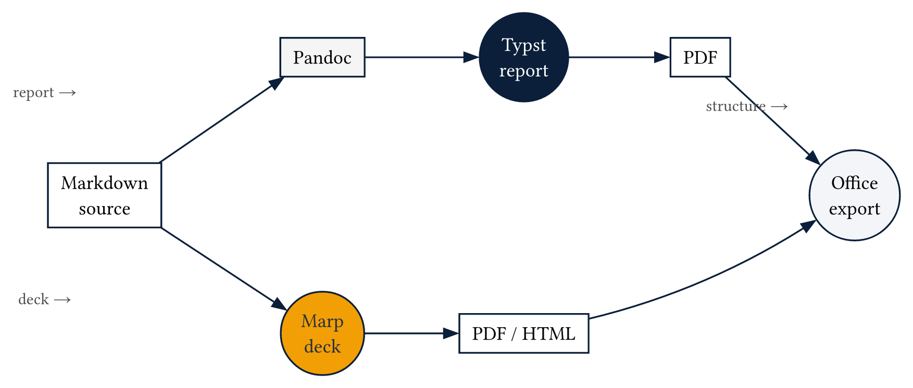
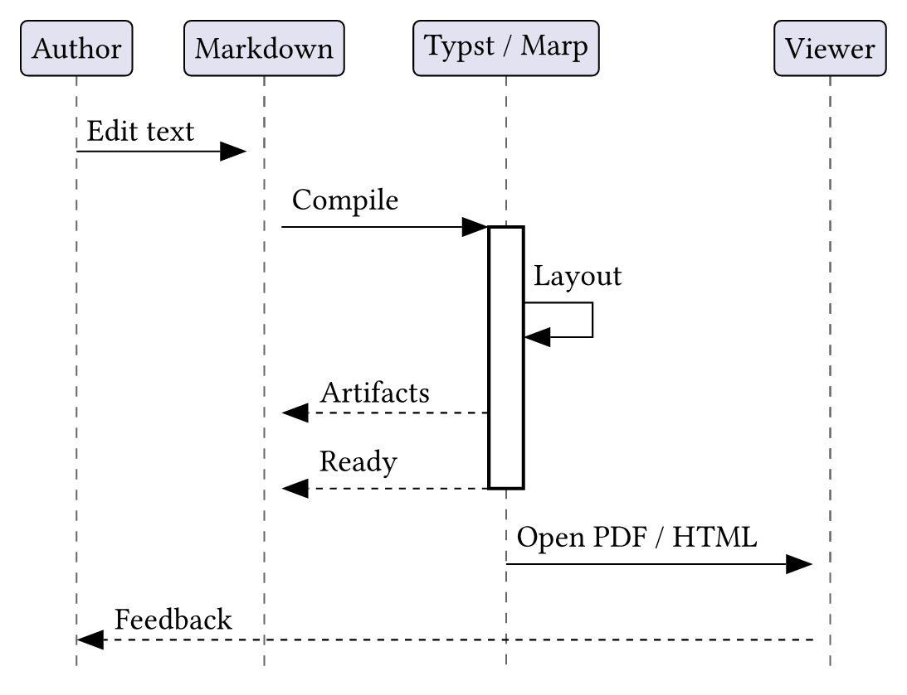

# Sample report

*Author: Doc pipeline · Browser MD preview*

This page checks images, tables, code, diagrams, and citations. Compare with `/sample/report.pdf`.

## Introduction

The Typst documentation covers raw-block styling [@typstDocs].
Pandoc stays in the export path [@pandocManual].


## Data

| Stage | Tool | What it keeps |
|---|---|---|
| Report | Typst | Page layout |
| Deck | Typst slides | Slide layout |
| Office | Pandoc | Structure |

*Tools and what they keep*

## Code

```python
def greet(name: str) -> str:
    # keep indentation in the box
    if not name:
        raise ValueError("empty name")
    return f"Hello, {name}"
```

## Diagrams




